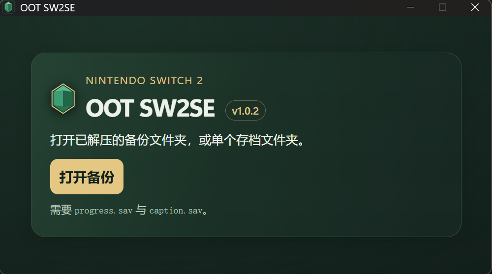
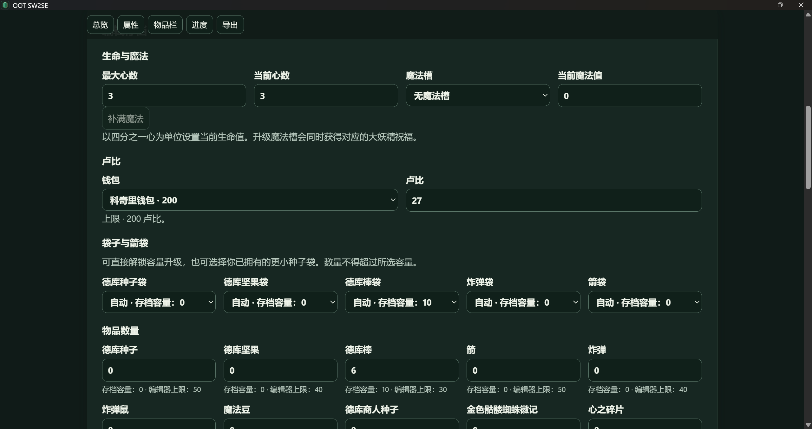
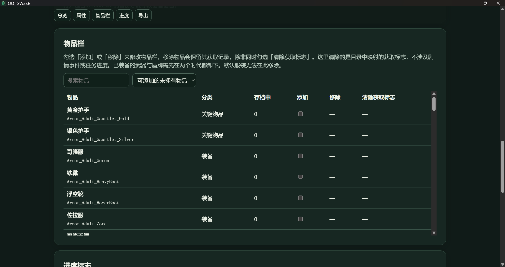

# OOT SW2SE 简体中文版

> 《塞尔达传说：时之笛》Nintendo Switch 2 重制版 **存档编辑器** 的第三方简体中文汉化版
> 基于 [Traiver/OOT-SW2SE](https://github.com/Traiver/OOT-SW2SE) v1.0.2 · Windows x64 · 免安装单文件

[](LICENSE)
[](#下载与使用)
[](https://github.com/Traiver/OOT-SW2SE)
[](#汉化范围)
[](#关于这次汉化)

> [!IMPORTANT]
> **本仓库是非官方汉化，不是原作者的仓库，也未获任何授权或认可。**
> 原作者：[**Traiver**](https://github.com/Traiver/OOT-SW2SE) · 原项目许可证：**MIT**
> 如果你想用原版（英文）工具，请直接去上游仓库下载。

---

## 目录

- [这是什么](#这是什么)
- [界面预览](#界面预览)
- [下载与使用](#下载与使用)
- [汉化范围](#汉化范围)
- [关于这次汉化](#关于这次汉化)
- [和上游版本的关系](#和上游版本的关系)
- [技术实现](#技术实现)
- [自行复现 / 重新汉化](#自行复现--重新汉化)
- [已知限制](#已知限制)
- [常见问题](#常见问题)
- [⚠️ 免责声明](#免责声明)
- [版权与署名要求](#版权与署名要求)
- [致谢](#致谢)

---

## 这是什么

[OOT SW2SE](https://github.com/Traiver/OOT-SW2SE) 是一个**离线存档编辑器**，用来编辑《塞尔达传说：时之笛》Nintendo Switch 2 重制版的存档：

- 生命值 / 魔法槽、卢比与钱包、弓箭炸弹等各类容量袋与数量
- 瓶子与瓶内物品、各区域小钥匙、对话语音语言
- 物品栏增删（含获取标志清理）、上千条进度标志的检索与开关
- 只读的字段查看器（按哈希 / 类型查看存档内所有字段）
- 导出「补丁 ZIP」或「补丁文件夹」，再合并回你的备份

原版界面是全英文的，对不熟悉游戏英文术语的玩家不太友好。**本仓库把整套界面汉化成了简体中文，功能与原版保持一致。**

汉化产物是**一个 exe**，绿色免安装：

```
OOT SW2SE 中文版.exe
```

---

## 界面预览

**启动界面**



**属性编辑（生命与魔法 / 卢比 / 容量袋）**



**物品栏（物品名、分类、操作列全部中文）**



---

## 下载与使用

### 系统要求

| 项目 | 要求 |
|---|---|
| 系统 | Windows 10 / 11 **x64**（在 Windows 11 10.0.28000 实测通过） |
| 运行时 | .NET Framework 4.8（Win10 1903 之后系统自带） |
| 渲染 | Microsoft Edge WebView2 Runtime（Win11 自带；Win10 若缺失请装一次） |
| 网络 | 不需要。全程离线运行 |

### 安装

不需要安装。下载 `OOT SW2SE 中文版.exe`，双击运行即可。

如果系统提示缺少 WebView2 运行时，去微软官网下载「Evergreen Bootstrapper」装一次就好。

### 三步用法

1. **打开备份** —— 点左上角的「打开备份」，选中你**已经解压出来的备份文件夹**（里面要能看到 `progress.sav` 和 `caption.sav`；整包备份则选包含 `files/` 的那一层）。
2. **改** —— 在「属性 / 物品栏 / 进度」里改。多槽位存档可以在「存档槽位」里切换。
3. **导出** —— 在「导出」区选：
   - **导出补丁 ZIP**：生成一个 ZIP，配合 Switch 备份还原工具使用；
   - **导出到文件夹**：生成补丁文件夹，手动合并进备份副本。

> [!WARNING]
> 导出的是**替换文件**，不是完整备份。请务必先复制一份原始备份再操作，改坏了还能退回去。

---

## 汉化范围

| 部分 | 状态 | 说明 |
|---|---|---|
| 界面标题、导航、按钮 | ✅ 已汉化 | 总览 / 属性 / 物品栏 / 进度 / 导出 |
| 所有小节标题与说明文字 | ✅ 已汉化 | 包括每条提示、注意事项 |
| 表单标签、下拉选项 | ✅ 已汉化 | 钱包、容量袋等级、魔法槽、语音语言… |
| 104 个物品名与分类 | ✅ 已汉化 | 黄金护手、大师之剑、哥隆服、关键物品 / 装备 / 道具… |
| 小钥匙区域、瓶内物品 | ✅ 已汉化 | 井底、森林神殿、格鲁德要塞、红色药水… |
| 表头、翻页、筛选状态 | ✅ 已汉化 | 「存档中」「补丁中」「已置位」「未置位」 |
| 全部报错与状态提示 | ✅ 已汉化 | 存档格式不符、字段哈希重复、瓶子字段不一致… |
| Windows 对话框 | ✅ 已汉化 | 「选择备份或存档文件夹」「选择文件夹」「保存补丁」 |
| 程序名 `OOT SW2SE` | ⛔ 保留英文 | 产品名，改了反而不好认 |
| 内部字段名 / 哈希 | ⛔ 保留英文 | 如 `HaveTalked_Special.Npc_...`、`0x1D6189DA`，这是存档里的真实标识，翻译就对不上了 |
| 字段类型 | ⛔ 保留英文 | `Bool` / `Int` / `Float` / `String64` 等，技术标识 |

术语按国内通译处理：**科奇里、哥隆、佐拉、德库、卢比、箭袋、徽章、大妖精、娜薇、加侬多夫**。

---

## 关于这次汉化

| 项目 | 内容 |
|---|---|
| 汉化完成时间 | 2026-11-16 |
| 使用的模型 | **DeepSeek-V4.1-Flash** |
| 汉化方式 | AI 逐条翻译 + 脚本化替换 + 人工逐屏截图核对 |
| 翻译条目 | 约 400 条界面文案 + 104 个物品名与分类 |
| 是否改动功能 | **没有**。只替换文案，所有逻辑、字段哈希、读写流程与原版逐字节一致 |

汉化过程不是「把网页另存为再翻译」那么随意，具体做了这些事：

1. 从 exe 里反抽出它自己内嵌的那份界面 HTML（而不是用仓库里更新的源码，见下一节）；
2. 逐条建立英中对照表，按「长串优先」替换，避免短词误伤；
3. 用 `node --check` 校验脚本语法，并逐行比对「剥掉字符串内容后的代码骨架」，确认**除文案外零改动**；
4. 跑上游自带的回归测试（`tests/editor.test.cjs`），确认存档读写逻辑没有被破坏；
5. 真实启动 exe，逐屏截图核对排版、断行、下拉选项。

---

## 和上游版本的关系

**本汉化对应的是上游发布的 v1.0.2 的 exe，不是仓库里最新的源码。**

上游仓库的 `editor.html` 比 1.0.2 的成品新，多出了「游泳深度」「写回源文件」「存档时间 / 最新槽位」等功能，但 1.0.2 的 exe 外壳（C# 部分）并不支持这些接口。如果直接拿仓库最新源码去替换，会出现「界面有按钮、点了没反应」的问题。

所以这里的做法是：**从 1.0.2 的 exe 里取出它自带的那份界面来翻译**，保证界面与外壳严格配套，功能与官方 1.0.2 完全一致。

等上游发布新版本，重新跑一遍汉化脚本即可（见下方「自行复现」）。

---

## 技术实现

<details>
<summary>点开看细节（不想看代码的可以跳过）</summary>

这个 exe 是个 .NET 单文件程序：界面全部在 `editor.html` 里，以 **gzip 压缩的嵌入资源**（`editor.html.gz`）打包进 exe；C# 那层只负责开窗口、弹文件对话框、读写存档文件。

因此汉化不需要重新编译，只需两件事：

**① 等长替换内嵌的界面资源**

直接把中文 HTML 压成 gzip 会变大 510 字节（中文比英文占字节），而资源表里的偏移和长度是写死的。解决办法是利用 gzip 规范里的 `FEXTRA` 扩展字段，把多出来的字节塞进头部填充区：

```
1F 8B 08 04 ...  <- FLG=0x04 表示带 FEXTRA
XLEN (2字节) + 填充字节 + 真正的 deflate 数据 + CRC32/SIZE 尾部
```

这样压缩流**总长度与原资源完全相同**（121,603 字节），清单资源表的 `offset` / `size` 一个字节都不用改，也不会影响 exe 里的其它三个 WebView2 DLL 资源。

**② 就地替换 C# 里的对话框文案**

窗口标题、文件夹选择框标题、保存对话框、报错弹窗这些字符串在 .NET 的 `#US`（用户字符串）堆里。做法是按 UTF-16LE 定位、替换成中文、不足处补 `U+0000`，**字节长度保持不变**，这样所有元数据偏移依然有效，显示时会自然在第一个 NUL 处截断。

**③ 验证**

- `node --check`：脚本语法
- 代码骨架比对：证明除字符串外零改动
- 上游回归测试：8 项通过（另 5 项「失败」是测试里断言英文报错文字，中文报错本身是对的）
- 真机启动 + 逐屏截图

</details>

---

## 自行复现 / 重新汉化

仓库里带了完整脚本，上游发新版时可以自己重跑：

| 文件 | 作用 |
|---|---|
| `editor.zh-CN.html` | 汉化后的界面（最终产物，可直接查看） |
| `localize_zh.py` | 英文界面 → 中文界面的翻译脚本（内置英中对照表） |
| `patch_exe.py` | 把中文界面写回 exe 的打包脚本（等长替换 + 字符串补丁） |
| `OOT SW2SE 中文版.exe` | 成品 |

```bash
# 1) 从官方 exe 抽出它自带的原始界面
python patch_exe.py "OOT SW2SE.exe" embedded-en.html

# 2) 生成中文界面
python localize_zh.py embedded-en.html editor.zh-CN.html

# 3) 打包成新的 exe
python patch_exe.py "OOT SW2SE.exe" editor.zh-CN.html "OOT SW2SE 中文版.exe"
```

需要 Python 3.8+，不依赖第三方库。脚本会在终端里提示哪些条目没命中（通常是新版新增的文案），照着补进对照表即可。

> 想改词？直接改 `localize_zh.py` 顶部的 `HTML_TEXT` / `QUOTED` / `ITEM_TITLES` 三张表，重跑即可。

---

## 已知限制

- **只对应上游 v1.0.2**，上游更新后需要重新汉化；
- 不含上游 1.0.2 之后新增的「游泳深度」「写回源文件」等功能（那是新版 exe 的能力，不是汉化能补的）；
- 只支持 Switch 2 重制版的存档格式（`progress.sav` + `caption.sav`），不适用于 N64 原版或 3DS 版；
- 存档内部的字段名与哈希保持英文——这是数据本身，不是没翻译；
- 界面字体走系统字体栈（微软雅黑 / Segoe UI），在极少数精简系统上可能字重略怪，不影响使用。

---

## 常见问题

**Q：双击没反应 / 闪退？**
多半是缺 WebView2 运行时。装一次微软官方的 Evergreen Runtime 再试。Win11 一般自带。

**Q：杀毒软件报毒？**
因为本版直接修改了 exe 的二进制资源段（换掉内嵌界面），启发式引擎可能误报。不放心的话，你可以用仓库里的两个脚本，从**官方原版 exe** 自己重新生成一遍，产物与这里的完全等价。

**Q：会改坏存档吗？**
编辑器只读写你选中的 `progress.sav` / `caption.sav`，导出的是补丁文件，不会动你的原始备份——**前提是你在操作前自己复制了一份备份**。请务必先备份。

**Q：为什么「字段查看器」里还是英文？**
那里显示的是存档内部的字段名和哈希（例如 `HaveTalked_Special.Npc_Kokiri_007_...`），是游戏自己写进存档的标识符，属于数据而非界面文案，翻译了反而查不到对应关系。

**Q：能出 macOS / Linux 版吗？**
上游有 macOS 与 Linux 版本，但本仓库只汉化了 Windows 的 exe。其它平台需要另外处理（Linux 版是 Python + 同一个 `editor.html`，理论上替换 HTML 就能用）。

**Q：汉化版会不会收集我的数据？**
不会。程序全程离线，不联网、不上传任何内容。

---

## 免责声明

> 本项目为非营利性质的非官方汉化，仅供**个人学习、研究与自用存档修改**。使用本项目即表示你已阅读并同意以下全部条款；由此产生的一切后果由使用者自行承担。

1. **非官方、无关联。** 本项目由第三方（个人）制作，与原作者 **Traiver** 无关，与 **任天堂（Nintendo）** 无任何隶属、合作或背书关系。原作者不对本汉化版的任何问题负责。

2. **仅限自用存档。** 本工具只应用于你**本人合法持有、本人导出**的存档文件。请勿用于处理他人的存档或来源不明的文件。

3. **修改存档有风险。** 存档编辑属于对二进制数据的直接改写，存在导致存档损坏、进度丢失、游戏异常的可能。**操作前请自行备份原始存档**，因未备份或误操作造成的数据丢失，本项目不承担任何责任。

4. **不提供游戏内容。** 本仓库**不包含**游戏本体、ROM、密钥、存档文件或任何受版权保护的游戏资源。你需要自备合法获得的游戏与备份。

5. **禁止商业用途。** 严禁将本项目（含汉化文本、脚本、打包产物）用于**售卖、付费代改、付费社群引流、打包进付费服务或任何形式的牟利行为**。转载请注明出处。

6. **禁止违规使用。** 不得将本工具用于在线作弊、影响他人游戏体验、绕过付费、违反任天堂用户协议或当地法律法规的任何用途。

7. **商标归属。** 《塞尔达传说》《时之笛》及相关名称、图像、角色均为任天堂的商标或注册商标。本项目仅为技术性文本本地化，不主张任何相关权利。

8. **按现状提供。** 本软件依 MIT 许可证「AS IS」提供，不附带任何明示或暗示的担保，包括但不限于适销性、特定用途适用性与不侵权担保。

9. **责任限制。** 在任何情况下，作者均不对因使用或无法使用本软件而产生的任何直接、间接、偶然、特殊或后果性损害承担责任。

10. **与 AI 服务商无关。** 汉化由 AI 辅助完成（DeepSeek-V4.1-Flash），不代表 DeepSeek 官方的立场、认可或背书。

11. **侵权处理。** 若权利人认为本仓库内容不妥，请通过 Issue 联系，核实后会立即删除相关内容。

---

## 版权与署名要求

- **原项目**：[Traiver/OOT-SW2SE](https://github.com/Traiver/OOT-SW2SE)，作者 **Traiver**，采用 **MIT 许可证**（`Copyright (c) 2026 Traiver`）。
- **汉化部分**：同样以 **MIT 许可证**发布，完整保留上游版权声明（见 [LICENSE](LICENSE)）。

**署名要求：**

- 转载、搬运、二次分发本汉化版，请**保留原作者 Traiver 的名字与上游仓库链接**，并注明汉化来源（本仓库）；
- 基于本汉化继续修改并发布，请在 README 中说明，不要抹去原作者信息；

---

## 致谢

- [**Traiver**](https://github.com/Traiver/OOT-SW2SE) —— 原版编辑器作者，界面、解析器、补丁生成逻辑全部出自其手，没有他就没有这个汉化；
- 上游 README 中提到的 **aut0mat3d / Claude** —— 贡献了存档时间、写回等特性；
- **DeepSeek** —— 提供 DeepSeek-V4.1-Flash 模型完成本次翻译与工程改造。
